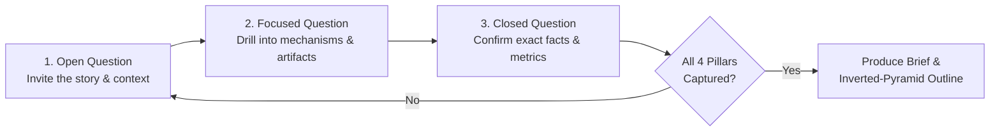
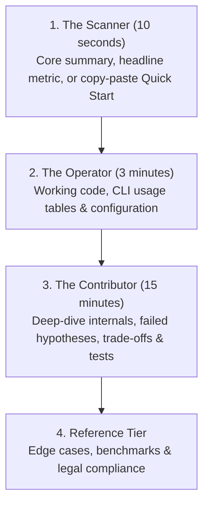

# Ideate: Socratic Discovery & Inverted-Pyramid Outlining

`ideate` unifies two foundational pre-writing disciplines: **Socratic technical interviewing** (extracting high-information-gain engineering reality before a single paragraph is drafted) and **Inverted-Pyramid Information Architecture** (ordering every document by descending reader value).

---

## 1. Mode Selection: Discovery Interview vs. Direct Structural Outlining

Choose your entry point based on how much raw material is already in context:

1. **Interactive Socratic Interview (Default for New Blog Posts & Articles)**:
   - When the user wants to brainstorm a post or says *"interview me about X"*, conduct a focused Socratic interview **one question at a time** to extract all 4 Pillars before generating the outline.
2. **Direct Inverted-Pyramid Outlining / Structural Refactoring**:
   - When the user already provides raw notes, code files, or an existing `README.md` / `SKILL.md` / draft to restructure, inspect the workspace artifacts directly and organize them into the target inverted-pyramid sequence.

---

## 2. Socratic Discovery: The 4 Pillars of Information Gain

Generic AI articles fail because they summarize public documentation and describe only the happy path. Your interview must extract four pillars of first-hand engineering experience:

| Pillar | What to Extract | Example Probing Question |
| :--- | :--- | :--- |
| **1. The Triggering Incident / Problem** | The specific production alert, customer bug, latency ceiling, or developer friction that forced action. | *"What was the exact failure metric or bottleneck that convinced you the existing implementation wouldn't hold up?"* |
| **2. Failed Hypotheses & Dead Ends** | The first one or two intuitive fixes that *did not work*, and the mechanism that broke them. | *"Before you landed on the final design, what was your first instinct—and how did that attempt fail?"* |
| **3. Concrete Artifacts** | Verbatim error logs, stack traces, `pprof` profiles, minimal before/after diffs, benchmark tables, or architecture diagrams. | *"Do you have the panic stack trace, `benchstat` output, or minimal code diff we can anchor the lead section around?"* |
| **4. Breakthrough & Engineering Trade-offs** | The specific insight that solved the problem, the measurable outcome, and the new operational boundaries introduced. | *"Once the fix went live, how did the metrics move—and under what conditions should another team avoid this approach?"* |

### The Open $\rightarrow$ Focused $\rightarrow$ Closed Interviewing Loop

Never overwhelm the author with a wall of questions. Ask **strictly one question per turn**, wait for the response, and progress through each pillar using the three-stage funnel:



- **Stage A — Open Question (Broad Context)**: Invite the author to tell the story in their own words (*"How did this bottleneck first show up in production?"*).
- **Stage B — Focused Question (Drilling for Specificity & Artifacts)**: When the author gives a high-level answer, ask for the concrete mechanism or artifact (*"Which allocation site sat at the top of the heap profile, and can we inspect that struct in the repo?"*).
- **Stage C — Closed Question (Verification & Transition)**: Summarize the technical mechanism in one crisp sentence to confirm accuracy before moving to the next pillar (*"So an unbuffered channel inside the retry loop pinned 4 MiB request bodies until the context expired—did I capture that accurately?"*).

### Interviewing Etiquette
- **One Question at a Time**: Never stack multiple unrelated questions in a single turn.
- **Cozy Web Peer Voice**: Speak like an inquisitive senior engineer at a whiteboard—warm, sharp, and grounded, never robotic or sycophantic.
- **Know When to Wrap Up**: Five to eight focused turns are typically enough to capture all four pillars. Do not drag out the interview once you have a clear thesis, real artifacts, and honest trade-offs.

---

## 3. Inverted-Pyramid Information Architecture

The **inverted pyramid** orders technical documents so the highest-value, most actionable conclusions appear at the very top. Instead of burying installation commands or headline metrics beneath paragraphs of chronological backstory, information cascades downward across three progressive reader personas:



| Persona | Time Budget | Primary Goal | Required Document Section | Failure Mode to Avoid |
| :--- | :--- | :--- | :--- | :--- |
| **The Scanner** | **10 seconds** | Determine *what* this project or post does, *why* it matters, and grab the headline metric or install command. | Title, **150-Word Lead Block**, and Quick-Start snippet. | Burying the core conclusion or install command below a 400-word philosophical preamble. |
| **The Operator** | **3 minutes** | Run the tool, configure CLI flags, or adapt the working code pattern to a live system. | Working code example, usage tables, and architecture overview. | Mixing internal contributor build details into user-facing operational instructions. |
| **The Contributor** | **15 minutes** | Understand internal data structures, why alternative designs failed, benchmark methodology, and test suites. | Deep-Dive Mechanics, trade-offs, local build/test commands, and benchmarks. | Omitting why specific design trade-offs were chosen over standard alternatives. |

---

## 4. Document-Specific Structural Sequences

### A. The 4-Stage Technical Blog Post Sequence
Replace chronological diary writing (*"First we tried X, then Y..."*) with an outcome-first sequence:

1. **Stage 1 — Lead Block ($\le 150$ Words)**:
   - State the **problem**, the **architectural fix**, and the **measurable outcome** (latency drop, memory savings, throughput gain, or bug class eliminated) within the first 150 words.
   - *Example*: *"Replacing `encoding/json` reflection with a pre-compiled column reader cut our telemetry ingestion CPU usage by 44% and reduced p99 allocation stalls from 18 ms to 1.2 ms. Here is how the zero-copy parser works in Go 1.27."*
2. **Stage 2 — Working Code or Architecture Overview**:
   - Present the minimal working code snippet, API contract, or Mermaid architecture diagram immediately after the lead so *The Operator* gets the concrete artifact right away.
3. **Stage 3 — Deep-Dive Mechanics & Failed Hypotheses**:
   - Unpack *why* the solution works, why initial approaches fell short, and how the internal state machine or memory layout operates.
4. **Stage 4 — Benchmarks, Trade-offs & Operational Boundaries**:
   - Close with reproducible benchmark tables (`benchstat`, hardware specs, dataset size), honest operational costs, and when *not* to use this pattern.

### B. The 6-Part `README.md` Sequence
User-facing repository `README.md` files follow this strict six-part order:
1. **Title and high-impact summary**: State what the project does, the problem it solves, and its runtime/protocol in 1–2 crisp paragraphs.
2. **Prescribed actions (Quick start)**: Provide copy-pasteable installation and first-run commands within the first 10 seconds of reading.
3. **User documentation and usage guides**: Document subcommands, UI modes, MCP tools, flags, and workflows using scannable tables.
4. **Developer instructions**: Explain how to clone, build from source, and run unit/integration test suites.
5. **Development documentation**: Detail internal package structure, extension points, and architecture when helpful for maintainers.
6. **Legal and compliance**: Conclude with license terms (`Apache-2.0`, `MIT`) and mandatory disclaimers.

### C. The Agent Skill (`SKILL.md`) Sequence
When outlining or structuring an Agent Skill (`SKILL.md`):
1. **YAML Frontmatter**: `name`, high-signal `description` with explicit activation triggers, `license`, and `metadata` (`category`, `tags`, `author`, `version`).
2. **Core Role & Workflow Overview**: 1-paragraph mission statement followed by a Mermaid decision/workflow diagram.
3. **Deterministic Step-by-Step Playbook**: Concrete rules, command invocations, and scannable decision tables.
4. **Output Templates & Verification Checklists**: Copy-pasteable Markdown output formats and self-check gates.
5. **Operational Constraints**: Explicit boundaries (no fabricated artifacts, no unauthorized git mutations).

---

## 5. Deliverable: Structured Brief & Inverted-Pyramid Outline Template

Once discovery is complete, synthesize the material into this exact template so [`draft`](../draft/SKILL.md) can write the document without guessing:

```markdown
# Article Brief & Outline: [Working Title in Sentence Case]

Open in [Speedgrapher](sidecar://speedgrapher/panel/)

## 1. Narrative & Persona Metadata
- **Document Type**: [Technical Blog Post | README.md | Architecture Doc | SKILL.md]
- **Target Audience**: [e.g., Go backend engineers, Kubernetes operators, AI agent builders]
- **150-Word Lead Hook (The Scanner — 10s)**: [1–3 crisp sentences stating the exact problem, architectural solution, and headline metric or command]
- **Voice & Perspective**: [e.g., First-person plural engineering postmortem (`we`) / Direct instructional (`you`)]

## 2. The 4 Pillars of Information Gain
- **Triggering Incident / Problem**: [Specific pain point, symptoms, and scale]
- **Failed Hypotheses & Dead Ends**: [What was tried first and why it broke]
- **Concrete Artifacts Collected**:
  - [Artifact 1: e.g., `pprof` output / error log]
  - [Artifact 2: e.g., Minimal before/after code snippet]
  - [Artifact 3: e.g., Benchmark comparison table or Mermaid diagram]
- **Breakthrough & Engineering Trade-offs**: [Measurable impact and conditions where this approach should be avoided]

## 3. Inverted-Pyramid Section Outline

### 1. [Lead section heading in sentence case] (The Scanner — 10s)
- **Lead hook**: [Headline metric, problem, and core solution within 150 words]
- **Immediate takeaway**: [What the reader walks away with immediately]

### 2. [Working code or quick-start implementation] (The Operator — 3m)
- **Primary artifact**: [Minimal runnable code block, CLI command, or system diagram]
- **Why before how**: [The constraint this snippet solves and the key lines to inspect]

### 3. [Why initial approaches fell short & deep-dive mechanics] (The Contributor — 15m)
- **Dead end analyzed**: [Why the naive approach failed under load or edge cases]
- **Internal mechanism**: [Step-by-step walkthrough of the winning architecture]

### 4. [Benchmarks, trade-offs, and operational limits] (Reference Tier)
- **Verification metrics**: [Before vs. after table with explicit units]
- **When to avoid**: [Honest trade-offs and operational boundaries]
```

---

## Operational Constraints

- **No Premature Full Drafting**: During an interactive interview, do not dump a 2,000-word article before the author confirms the outline (unless they explicitly ask to skip straight to drafting).
- **No Fabricated Artifacts**: Never invent benchmark numbers, stack traces, or production incidents. If an artifact is not yet available, mark it clearly as `[TODO: Insert benchmark output]`.
- **No Git Operations**: Never run `git commit`, `git push`, or other repository mutation commands.
