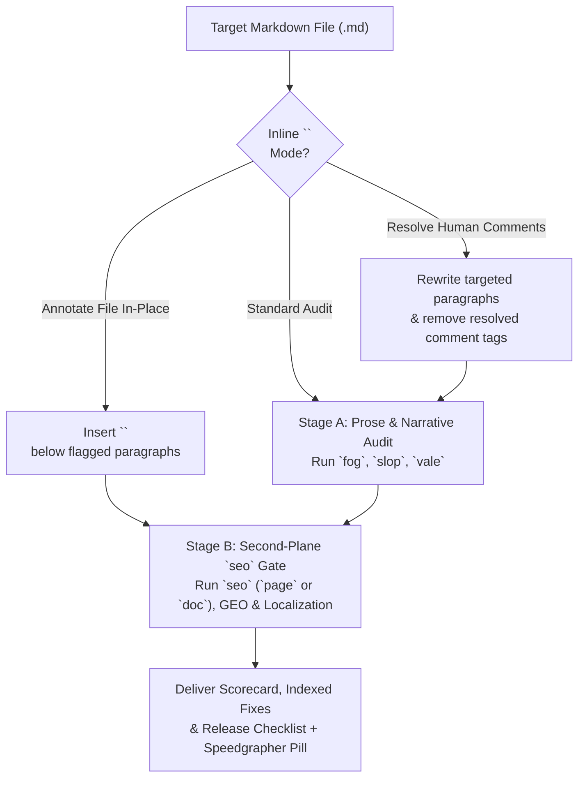

# Publish: Editorial Review, Inline Annotations & SEO/GEO Release Gate

`publish` is Speedgrapher's unified quality and release gate. It operates in two progressive stages mirroring Speedgrapher's two-plane architecture:
- **Stage A (Prose & Structural Review — All Markdown Files)**: Audits readability (`fog`), AI-trope density (`slop`), static grammar/style (`vale`), macro-narrative flow, and bidirectional inline review comments (`<!-- review: ... -->`).
- **Stage B (Second-Plane Technical SEO, GEO & Localization — Blog Posts & Web Pages)**: Audits discoverability via the `seo` MCP tool (`doc_type: "page"` or `"doc"`), enforces the dual-purpose frontmatter split (`summary` vs. `description`), validates Generative Engine Optimization (GEO) signals, and guides idiomatic multi-language localization.

---

## 1. Two-Stage Review & Release Pipeline



Whenever you review or prepare a `.md` file for release, always surface the side-panel pill at the top of your response:

> Open [file.md](sidecar://speedgrapher/panel/?file=/absolute/path/to/file.md) to inspect live diagnostics, inline comments, and SEO telemetry in the side pane.

---

## 2. Stage A: Prose Quality Gate & Inline Review Comments (All Markdown Files)

### A. Quantitative MCP Prose Diagnostics
Run `fog`, `slop`, and `vale` on the target `.md` file using its absolute `path`:

| MCP Tool | Scope & Granularity | Target Threshold | Action When Out of Bounds |
| :--- | :--- | :--- | :--- |
| **`fog`** | Document-wide & per-paragraph Gunning Fog Index (`paragraphs[]`). | **11.0 – 15.0** | **$> 15.0$**: Flag compound sentences ($> 30$ words) and bureaucratic noun stacks for splitting.<br>**$< 11.0$**: Check for choppy staccato fragments or oversimplified explanations. |
| **`slop`** | Document-wide & per-paragraph 5-Dimension AI Slop Score (`0–100`). | **$< 20$** (Clean)<br>**$\ge 25$** (Warning) | Flag every lexical tell (*delve*, *tapestry*, *leverage*, *utilize*, *robust*, *quietly*), negative parallelism (*"It's not X — it's Y"*), and uniform-cadence paragraph. |
| **`vale`** | Static style & grammar linter (`Google`, `proselint`, `write-good`). | **0 errors / 0 warnings** | Filter out false-positive spelling alerts on valid code identifiers, and flag passive voice, weasel words, and title-case headings. |

### B. Qualitative Editorial Audit Criteria
Inspect the manuscript line by line against six qualitative standards:
1. **Inverted-Pyramid & Macro-Narrative Momentum**: Does the opening 150 words state the core problem, solution, and headline metric? Do later sections maintain forward momentum without re-litigating the introduction?
2. **Functional Precision vs. Status-Signaling Jargon**: Are domain acronyms defined on first use? Have bureaucratic noun stacks been replaced with active verbs?
3. **Canonical Citation Hygiene**: Are tools, libraries, and open standards hyperlinked by their canonical name on first mention (for example, `[Model Context Protocol](https://modelcontextprotocol.io)`), with zero bare URLs printed in prose?
4. **Grounded Code Pedagogy**: Is every code block introduced with *why* before *how*?
5. **Sentence-Case Headings**: Do all headings (`H1`–`H4`) use strict sentence case?
6. **Google Developer Brand & Legal Safety**: Flag unverifiable superlatives (*"fastest"*, *"best"*), possessives on product names (*"Google's Cloud Run's"*), unsubstantiated claims, or mentions of unreleased roadmaps (*"coming soon"*).

### C. Bidirectional Inline Review Comment Workflow (`<!-- review: ... -->`)

Speedgrapher uses HTML comments placed immediately below a paragraph as a zero-lock-in review bus, written either as plain `<!-- review: ... -->` tags or with UI metadata attributes `<!-- review(id="...", quote="...", ts="..."): ... -->`:

1. **Resolving Human Comments (`Human -> Agent`)**:
   - When the file contains `<!-- review: ... -->` or `<!-- review(...): ... -->` comments added by the author, locate every comment block.
   - Edit the preceding paragraph (or add the requested code/table) to fulfill the author's note while keeping `fog` ($11\text{–}15$) and `slop` ($< 20$) in bounds.
   - **Delete each resolved `<!-- review: ... -->` or `<!-- review(...): ... -->` comment** from the file once addressed.
2. **Injecting Agent Annotations (`Agent -> Human`)**:
   - When the user asks you to *annotate the file in place* or *leave inline review comments* (instead of rewriting the prose directly), insert concise `<!-- review: [Dimension] Concrete recommendation -->` comments directly beneath the affected paragraphs:
     ```markdown
     The orchestration layer utilizes a distributed lock methodology to facilitate state synchronization across worker nodes.
     <!-- review: [Readability / Slop] Replace noun stack and corporate verbs ("utilizes", "methodology", "facilitate") with direct active prose: "The coordinator acquires a Redis lease before syncing state across worker nodes." -->
     ```

### D. Mandatory Stage A Output: Scorecard + Line-Indexed Recommendations

Structure every editorial review using this exact template so the author can evaluate and apply findings by ID:

```markdown
## Editorial Review: `<filename.md>`

Open [file.md](sidecar://speedgrapher/panel/?file=/absolute/path/to/file.md)

### 1. Editorial Review Scorecard

| Dimension | Score / Status | Target | Assessment |
| :--- | :--- | :--- | :--- |
| **Readability (`fog`)** | `<score>` (`<N>` hotspot paragraphs) | `11.0 – 15.0` | `[Pass / Needs Simplification / Check Depth]` |
| **AI Slop (`slop`)** | `<score>/100` | `< 20` (Warn `>= 25`) | `[Pass / Minor Tells / High Slop Warning]` |
| **Static Analysis (`vale`)** | `<E> errors, <W> warnings` | `0 errors, 0 warnings` | `[Summary of Google / proselint / write-good findings]` |
| **Technical SEO (`seo`)** | `<score>/100` (`<N>/7` checks) | `>= 85` (`7/7` passed) | `[Summary of metadata, heading, alt-text, and link checks]` |
| **Narrative & Jargon Hygiene** | `[Strong / Needs Tightening]` | Inverted pyramid & plain English | `[1-sentence assessment of 150-word lead, jargon, and citations]` |

### 2. Executive Assessment
[2–3 concise sentences summarizing the draft's core strengths, voice alignment, and highest-leverage improvements.]

### 3. Line-Indexed Recommendations
[Exhaustive numbered list of every specific issue identified. Never group distinct line edits.]

- `[1] Line <N> | Dimension: <Fog|Slop|Vale|SEO|Jargon|Narrative> | Context: "<exact excerpt>" | Suggestion: "<concrete rewrite or structural fix>"`
- `[2] Line <N> | Dimension: <Fog|Slop|Vale|SEO|Jargon|Narrative> | Context: "<exact excerpt>" | Suggestion: "<concrete rewrite or structural fix>"`
```

Unless the user explicitly asked you to auto-fix or annotate the file in a single pass, invite them to respond with selective commands (`"apply all"`, `"apply 1, 3, 5"`, `"annotate in file"`, or `"discuss 2"`).

---

## 3. Stage B: Second-Plane Technical SEO, GEO & Localization Gate

For blog posts, tutorials, and web documentation (`doc_type: "page"`), execute the full second-plane discoverability audit using the `seo` MCP tool.

### A. The Dual-Purpose Metadata Split (`title`, `summary`, `description`, `canonical`)
Static site generators (Hugo, Astro, Next.js) and AI retrieval pipelines consume frontmatter fields for distinct purposes. Always separate the human feed teaser from the search/LLM factual answer:

| Frontmatter Field | Length Target | Primary Consumer | Writing Strategy | Example |
| :--- | :--- | :--- | :--- | :--- |
| **`title`** | **30–60 chars** | Browser tabs, SERP headlines, social cards | Front-load the primary technical subject and concrete mechanism in sentence case. | `"Zero-allocation JSON parsing in Go 1.27"` |
| **`summary`** | **80–180 chars** | Human readers browsing blog index cards, RSS feeds, and newsletters | Write a compelling editorial hook that highlights the engineering tension or debugging story without giving away every detail. | `"When our telemetry cluster hit 40% CPU in reflection stalls, we replaced encoding/json with a pre-compiled column reader."` |
| **`description`** | **120–160 chars** | Search engine snippets (`<meta name="description">`) and LLM/RAG retrieval indices (GEO) | Write a self-contained, factual answer stating *what* the article covers, exact runtime versions, and the measurable result. | `"Learn how to build a zero-allocation JSON column reader in Go 1.27 that cuts CPU overhead by 44% and keeps p99 latency under 1.2 ms."` |
| **`canonical`** | **Valid HTTPS URL** | Search engine crawlers (`<link rel="canonical">`) | Specify the authoritative URL for syndicated or cross-posted articles. | `"https://example.dev/blog/zero-alloc-json-go/"` |

```yaml
---
title: "Zero-allocation JSON parsing in Go 1.27"
date: 2026-10-12
summary: "When our telemetry cluster hit 40% CPU in reflection stalls, we replaced encoding/json with a pre-compiled column reader."
description: "Learn how to build a zero-allocation JSON column reader in Go 1.27 that cuts CPU overhead by 44% and keeps p99 latency under 1.2 ms."
canonical: "https://example.dev/blog/zero-alloc-json-go/"
tags: ["go", "performance", "json", "memory-management"]
---
```

### B. The 7-Point `seo` Verification Gate (`checks[]`)
Run `speedgrapher`'s `seo` MCP tool (`path`, `doc_type: "page"` for web posts or `"doc"` for repository docs, and target `keyword`) and verify all seven `checks[]` pass:

1. **`Title Tag` (`30–60 chars`)**: Clear `title` frontmatter key or document `# H1` between 30 and 60 characters (and containing the target `keyword` when provided).
2. **`Meta Description` (`120–160 chars`)**: `description` frontmatter field (or `<meta name="description">`) present and between 120 and 160 characters (skipped in `doc_type: "doc"` mode).
3. **`H1 Tag`**: Exactly one `H1` (`# ` or `<h1>`) on the page, or a frontmatter `title` that renders as the page `H1`.
4. **`Image Alt Text`**: Every Markdown image (``) and HTML `` tag carries non-empty `alt` text.
5. **`Links`**: At least one hyperlink (`[anchor](url)` or `<a href="...">`) connects the document to upstream documentation or related resources.
6. **`Content Length`**: At least 300 words for `doc_type: "page"` (or 100 words for `doc_type: "doc"`).
7. **`Canonical Tag`**: `canonical` frontmatter key (or `<link rel="canonical">`) present for `doc_type: "page"` (skipped in `doc_type: "doc"` mode).

### C. The 6-Point Generative Engine Optimization (`geo_checks[]`) Checklist
Alongside the 7 SEO checks, `seo` evaluates six `geo_checks[]` to maximize accurate citation by LLM search engines, RAG pipelines, and developer agents:

1. **`Dual-Purpose Metadata Split` (`summary` 80–180 chars vs. `description` 120–160 chars)**: Both `summary` (editorial human hook, 80–180 chars) and `description` (factual answer-engine summary, 120–160 chars) are present and distinct (skipped in `doc_type: "doc"` mode).
2. **`Inverted Pyramid Lead`**: The opening paragraph (40–150 words) states the core conclusion or problem and solution immediately rather than burying the lead.
3. **`Quotability & Code Hygiene`**: Every code block is introduced by explanatory prose (*why* before *how*) rather than dropped immediately under a heading.
4. **`Heading Hierarchy & Sentence Case`**: Headings descend sequentially (`H1` $\rightarrow$ `H2` $\rightarrow$ `H3`) with zero skipped levels and use strict sentence case.
5. **`Descriptive Image Alt-Text`**: Image `alt` attributes describe the architectural state or chart trend (`>= 10 chars`), never raw filenames (`diagram.png`) or generic placeholders (`image`, `screenshot`).
6. **`Link & Anchor Hygiene`**: Links use descriptive domain noun phrases (`[Go memory model specification](https://go.dev/ref/mem)`) rather than vague anchors (*"click here"*, *"read more"*) or bare URLs in prose.
- **Structured Data (`TechArticle` JSON-LD) & `/llms.txt` Awareness**: When auditing full web pages or Hugo templates, verify that `TechArticle` or `BlogPosting` JSON-LD schema metadata (`headline`, `description`, `datePublished`, `author`) is populated and that site documentation indexes key pages cleanly for `/llms.txt` discovery.

---

## 4. Technical Localization Rules

When translating an article or documentation file into target languages (such as `pt-br`, `es`, `ja`, `de`, `fr`, or `zh`):

1. **Preserve Technical Acronyms & Protocol Tokens**: Never translate industry-standard acronyms or identifiers (`API`, `CLI`, `JSON`, `gRPC`, `LLM`, `MCP`, `SDK`, `SSE`, `WASM`, `eBPF`, `p99`).
2. **Preserve Brand & Product Names**: Keep official product, language, and platform names invariant (`Go`, `Gemini`, `Google Cloud`, `Cloud Run`, `Kubernetes`, `Antigravity`, `Speedgrapher`).
3. **Preserve Code Blocks & Frontmatter Keys**:
   - Keep all YAML/TOML frontmatter keys (`title`, `date`, `summary`, `description`, `canonical`, `tags`) in English; translate only the human-readable string values (`title`, `summary`, `description`).
   - Keep code blocks, CLI commands, file paths, and log outputs untouched (you may translate explanatory comments inside code blocks when helpful).
4. **Idiomatic Adaptation & Length Re-Verification**: Translate prose naturally for native engineers in the target locale rather than word-for-word calques, then re-verify that the localized `title` (30–60 chars), `summary` (80–180 chars), and `description` (120–160 chars) still fit within their character windows.

---

## 5. Final Release Checklist Deliverable

When wrapping up a pre-publication audit, provide a ready-to-execute **Release Plan**:
- **Quality & SEO Gate Summary**: Pass/fail table for `fog` ($11\text{–}15$), `slop` ($< 20$), `vale` (`0` warnings), and `seo` ($\ge 85$, `7/7` checks).
- **Validated Frontmatter Block**: Ready-to-paste YAML/TOML frontmatter containing `title`, `summary`, `description`, and `canonical`.
- **Target File Path**: Recommended path following the repository's convention (for example, `content/posts/<slug>/index.md` or `index.<lang>.md`).
- **Proposed Git Commit Message**: A conventional commit message (for example, `docs(blog): publish zero-allocation json parsing post`) for the author to run manually.

---

## Operational Constraints

- **No Git Operations**: Never execute `git add`, `git commit`, `git push`, or `git tag` yourself. Provide the exact commands in the Release Plan for the user to run.
- **Explicit User Sign-Off**: Never overwrite production content files without the author's confirmation unless explicitly instructed.
