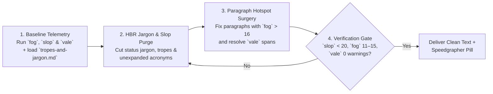

# Readability: jargon mitigation, deslopification & copyediting

`readability` turns dense, bureaucratic, or synthetic drafts into clear, human-authored technical prose. It combines three complementary disciplines:

1. **The 4-Step HBR Framework** to remove status-signaling jargon and raw acronyms while preserving technical accuracy.
2. **The 5-Dimension AI Slop Purge (`deslopify`)** to eliminate LLM clichés and re-establish natural syntax.
3. **Per-Paragraph `fog` and `vale` Hotspot Remediation** to fix density issues via Speedgrapher MCP metrics and [`references/tropes-and-jargon.md`](references/tropes-and-jargon.md).

---

## 1. Why Technical Prose Gets Bogged Down: The HBR Jargon Insight

Writing loaded with jargon signals insecurity, not mastery. They found that professionals who feel low status lean on unexpanded acronyms and abstract vocabulary to manufacture authority. The strategy backfires: readers trust plain, concrete explanations more. In ["Does Your Office Have a Jargon Problem?"](https://hbr.org/2021/03/do-you-have-a-jargon-problem) (*Harvard Business Review*, March 2021), Zachariah Brown, Eric M. Anicich, and Adam D. Galinsky analyzed thousands of texts to track why people hide behind buzzwords.

### Functional Precision vs. Status-Signaling Jargon

Technical copyediting must never "dumb down" real engineering concepts. Before cutting a technical term, classify it into one of two buckets:

| Classification | Definition | Examples | Editorial Action |
| :--- | :--- | :--- | :--- |
| **Functional Precision (KEEP)** | Exact computer science primitives, protocol names, syscalls, or metrics that have no simpler accurate synonym. | `mutex`, `goroutine`, `idempotent`, `B-tree page split`, `p99 latency`, `CRC32C checksum`, `epub`, `mmap` | **Keep the term.** If the term is an acronym or domain-specific concept that a cross-functional reader (*The Scanner*) might not know, define it briefly on first mention. |
| **Status-Signaling Jargon (PURGE)** | Bureaucratic noun stacks, slide-deck metaphors, and inflated verbs used to sound impressive rather than specify a mechanism. | *orchestration layer validation methodology*, *operationalize*, *leverage*, *utilize*, *holistic paradigm*, *single pane of glass* | **Purge immediately.** Replace with the concrete system actor, a plain active verb (*use*, *run*, *validate*), and the exact mechanism. |

### The 4-Step HBR Jargon Mitigation Framework

Apply these four steps from the HBR framework to every document you edit:

1. **Start at the Top (Unambiguous Titles & Opening Leads)**:
   - Strip insider code names, unexpanded acronyms, and buzzword stacks from the document title, frontmatter `summary`/`description`, and the opening 150-word lead block so any technical reader immediately grasps the topic.
2. **Identify Jargon Tripwires & Unexpanded Acronyms**:
   - Scan for clusters of three or more consecutive multi-syllable nouns (*"resource utilization optimization strategy"*) and undefined initialisms (*"E2E CIL SLOs"*).
3. **Check Yourself (Plain-English Substitutions & First-Use Definitions)**:
   - Expand unfamiliar acronyms on first use—for example, *"extended Berkeley Packet Filter (eBPF)"* or *"Generative Engine Optimization (GEO)"*—while leaving universally understood primitives (`HTTP`, `JSON`, `CPU`, `API`, `URL`, `CLI`, `SQL`) unexpanded unless writing for beginners.
   - Replace every corporate verb (*utilize*, *leverage*, *operationalize*, *facilitate*) with its direct plain-English equivalent (*use*, *run*, *help*).
4. **Write to Be Understood, Not to Impress**:
   - Whenever a sentence hides a simple engineering trade-off behind formal passive abstractions (*"A determination was made to effectuate memory reclamation"*), rewrite it with an explicit subject and active verb (*"The collector frees unused heap buffers every five seconds"*).

---

## 2. The 5-Dimension AI Slop Purge (`deslopify`)

When `speedgrapher`'s `slop` MCP tool audits a file, it scores synthetic phrasing from 0 to 100 across five dimensions. Load [`references/tropes-and-jargon.md`](references/tropes-and-jargon.md) and purge every matched pattern:

| Dimension | What `slop` Measures | Common Failure Mode | Target Remediation |
| :--- | :--- | :--- | :--- |
| **1. Structural** | Rhetorical templates: negative parallelisms, dramatic countdowns, self-answering questions, and bold-first listicles. | Framing routine technical points as dramatic reveals (*"It's not X — it's Y"*, *"Not X. Not Y. Just Z."*). | Rewrite into single affirmative cause-and-effect clauses; convert mechanical `**Bold**: Text` lists into prose or comparison tables. |
| **2. Lexical** | High-probability LLM vocabulary (*delve*, *tapestry*, *landscape*, *paradigm*, *testament*, *beacon*, *catalyst*, *robust*, *seamless*) and magic adverbs (*quietly*, *deeply*, *fundamentally*, *merely*, *simply*). | Substituting ornate metaphors and unverified adjectives for concrete engineering properties. | Delete magic adverbs; replace inflated words with exact system nouns, failure modes, and metrics. |
| **3. Filler** | Throat-clearing transitions (*It's worth noting*, *Importantly*, *Here's the kicker*), copula evasions (*serves as*, *stands as*), and fractal signposting (*Let's break this down*, *In conclusion*). | Padding transitions without adding technical information. | Delete signposts and replace copula evasions with *is* or *are*. |
| **4. Rhythm Variance** | Sentence-length Coefficient of Variation ($CV = \sigma / \mu$). | Monotonous 15–20 word sentences or choppy staccato fragments. | Alternate short diagnostic statements (5–8 words) with compound technical explanations (20–28 words). |
| **5. Syntactic Voice** | Ratio of abstract nominalizations and passive constructions to active verbs and concrete subjects. | Hiding system agency behind noun stacks (*"The execution of the validation step..."*). | Restore concrete subjects (*we*, *the scheduler*, *the client*) and active verbs. |

---

## 3. Deterministic 4-Step Readability & Copyediting Workflow

Execute this four-step loop whenever improving a file's readability or deslopifying a draft:

### Step 1: Baseline Telemetry (`fog`, `slop`, `vale`)

Run `fog`, `slop`, and `vale` on the target `.md` file and load [`references/tropes-and-jargon.md`](references/tropes-and-jargon.md):

- Inspect both the document-wide scores and the **per-paragraph `paragraphs[]` breakdown** (`start_line`, `end_line`, `fog`, `slop`, `classification`) returned by `fog` and `slop`.
- Identify specific paragraph hotspots (paragraphs where `fog > 16.0` or `slop >= 25`) and exact `vale` line/column alerts so you only rewrite paragraphs that need work rather than churning clean sections.

### Step 2: HBR Jargon & AI Trope Purge

Apply the **4-Step HBR Jargon Mitigation Framework** and the diagnostic tables in [`references/tropes-and-jargon.md`](references/tropes-and-jargon.md):

- Replace status-signaling buzzwords and bureaucratic noun stacks with plain verbs and exact system actors.
- Expand unfamiliar domain acronyms on first mention.
- Strip lexical tells (*delve*, *tapestry*, *landscape*, *leverage*, *utilize*, *robust*, *seamless*), magic adverbs (*quietly*, *deeply*, *merely*, *simply*), negative parallelisms (*"It's not X — it's Y"*), and excessive em-dashes (`—`).

### Step 3: Per-Paragraph `fog` & `vale` Hotspot Surgery

For every paragraph flagged in `paragraphs[]` or by `vale`:

- **When Paragraph `fog` $> 16.0$**:
  - Split compound sentences longer than 28–30 words into two distinct sentences.
  - Convert multi-syllable nominalizations (*implementation*, *utilization*, *configuration*, *orchestration*, *determination*) into short active verbs (*build*, *use*, *set*, *coordinate*, *decide*).
- **When Paragraph `fog` $< 10.0$**:
  - Check for robotic staccato fragments (*"Fixing small bugs. Updating CI runners."*) and combine them into cohesive clauses.
- **When `vale` Reports `error` or `warning` Spans**:
  - Apply `vale`'s deterministic replacement suggestions for weasel words, passive voice clusters, wordiness, and sentence-case headings.
  - If a `vale` rule produces a genuine false positive on a domain term across the project, note that the author can mute the rule or add the term to the custom vocabulary via the `Mute Rule` / `+ Add to Vocab` buttons in the alert popover, or the `⚙️` Settings modal in Speedgrapher.

### Step 4: Verification Gate

Re-run `fog`, `slop`, and `vale` on the edited file to verify measurable improvement:

- **Target `slop` Score**: **$< 20$** (never finish with a Slop Score $\ge 25$).
- **Target `fog` Index**: **$11.0\text{–}15.0$** overall, with no individual narrative paragraph stranded in the `hard` ($> 18$) bucket.
- **Target `vale` Status**: **0 errors and 0 warnings**.
- Report a concise **Before $\rightarrow$ After Telemetry Table** (`fog`, `slop`, and `vale` counts) and surface `[file.md](sidecar://speedgrapher/panel/?file=/absolute/path/to/file.md)`.

---

## 4. Before & After Transformation Example

### Before (`slop`: 68 | `fog`: 19.2 | Status-Signaling Jargon + AI Tropes)

> In today's fast-paced distributed systems landscape, observability isn't just a nice-to-have — it's a foundational paradigm. Let's delve into how our E2E telemetry orchestration methodology quietly utilizes L7 CIL ring buffers to operationalize trace collection.
>
> Here's the kicker: traditional head-based sampling strategies leverage naive probabilistic decisions. The result? Blind spots during critical latency spikes.
> - **Resilience**: Leverages lock-free ring buffers to prevent data loss.
> - **Efficiency**: Seamlessly compresses spans before network transmission.
> - **Scalability**: Serves as a robust catalyst for high-cardinality debugging.

### After (`slop`: 6 | `fog`: 13.1 | Functional Precision + Clean Human Cadence)

> Head-based trace sampling drops 99% of requests at ingress, which often discards the exact traces needed to debug a p99 latency spike. To capture every slow or failing request without storing every healthy one, we moved our sampling decision to the collector tier.
>
> Each collector holds spans in a lock-free ring buffer for five seconds while waiting for the root span to finish. If any span in the trace records an HTTP `5xx` status or exceeds 250 ms, the collector compresses the full trace with Zstandard and flushes it to storage. Otherwise, it drops the buffer. Across 140 Go services in production, this tail-based pipeline cut trace storage volume by 62% while keeping 100% of error traces.

---

## Operational Constraints

- **Preserve Technical Accuracy**: Never alter code blocks, CLI flags, benchmark numbers, API signatures, or URLs while copyediting surrounding prose.
- **Preserve Author Voice**: Strip status-signaling jargon and synthetic LLM tropes without flattening the author's natural personality, dry humor, or first-person engineering stories.
- **No Git Operations**: Never execute `git commit`, `git push`, or other repository mutation commands.
