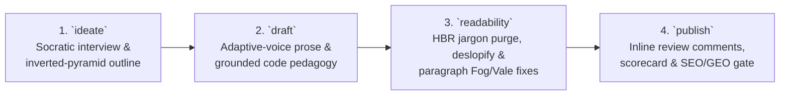

# Speedgrapher: Master Orchestrator & Side-Panel Editor (`/speedgrapher`)

`speedgrapher` pairs an interactive Antigravity side-panel workspace with a deterministic Go [Model Context Protocol](https://modelcontextprotocol.io) server and four specialized writing lifecycle skills (`ideate`, `draft`, `readability`, and `publish`).

---

## 1. Opening the Side Panel

Whenever the user invokes `/speedgrapher`, or creates, edits, or reviews a `*.md` document, surface a one-click `sidecar://` pill in chat while keeping standard `[filename.md](file:///...)` links for Antigravity's built-in Markdown viewer:

1. **Resolve the target `.md` file (if any)**:
   - If the user passed a filename or path (for example, `/speedgrapher README.md`), or if a `.md` draft is currently in scope, resolve its absolute path on disk.
2. **Surface the `sidecar://` deep link in chat**:
   - **With a target `.md` file**:
     ```markdown
     Open in [Speedgrapher](sidecar://speedgrapher/panel/?file=/absolute/path/to/file.md)
     ```
   - **Without a specific file**:
     ```markdown
     Open [Speedgrapher](sidecar://speedgrapher/panel/)
     ```

---

## 2. Four Workspace Modes (`Reader` | `Editor` | `Reviewer` | `Raw`)

Speedgrapher separates clean reading, live block editing, inline comment review, and raw source editing through a 4-mode segmented **`[ Reader | Editor | Reviewer | Raw ]`** toggle in the top bar:

| Mode | Purpose | Active Capabilities |
| :--- | :--- | :--- |
| **Reader Mode** (Default) | Final visualization of the Markdown document without body clutter. | Renders 100% GFM Markdown (images, tables, code blocks, GitHub alerts, task lists, math, and YAML/TOML frontmatter cards) with zero inline review cards or diagnostic highlights in the body. Hovering any block reveals a **`💬 Comment`** button that opens a popup window loading any existing comments on that block to edit/resolve, or allowing the user to add a new comment. Clicking **`Send Comments`** resolves open notes in memory via the panel's built-in AI client, while **`💬 Send to Main Chat`** shares context with the main Antigravity agent. |
| **Editor Mode** | Live block-level editing, visual prose telemetry, in-panel AI rewrites, and second-plane SEO/GEO auditing. | Click any block to edit its Markdown in place with `⌘Z` / `⌘Y` (`⇧⌘Z`) undo/redo, toggle **Editorial Lenses** (`Heatmap`, `Slop`, `Vale`, `Fog`), inspect **Before $\rightarrow$ After Fix Previews**, run **`✨ Rewrite with AI`** or **`3-Angle Variant Tournament`**, review staged **`✓ Accept Change` / `✕ Reject`** diff cards, and open the **Second-Plane `SEO & GEO` Popover**. |
| **Reviewer Mode** | Dedicated review pass with inline comment threads and diagnostic lenses. | Locks direct prose editing while rendering all `<!-- review: ... -->` and `<!-- review(...): ... -->` comment threads visibly inline in the document body below their paragraphs (with `Edit` and `✓ Resolve` controls) alongside **Editorial Lenses** (`Heatmap`, `Slop`, `Vale`, `Fog`) and **`Send Comments`**. |
| **Raw Mode** | Full-document raw Markdown source editor. | Opens the entire `.md` file in a clean monospace editor with live two-way sync to disk and `⌘Z` / `⌘Y` (`⇧⌘Z`) undo/redo. |

### Editorial Lenses, In-Panel AI Client & Visual Telemetry in Editor Mode

1. **Editorial Lenses (`.lens-cluster`)**:
   - **`Heatmap`** (Active by default in Editor Mode): Color-tints paragraph backgrounds across a 7-color health spectrum (`pristine`, `clean`, `mild`, `fair`, `warn`, `high`, and `bad`) based on combined per-paragraph Gunning Fog, AI Slop, and Vale health (`state.audit.blocks`). Clicking a paragraph's hover telemetry pill (`Fog · Slop · Vale`) opens a per-paragraph diagnostic breakdown.
   - **`Slop <score>`**: Underlines synthetic LLM vocabulary, magic adverbs, structural clichés, and passive voice spans.
   - **`Vale <count>`**: Underlines static style and grammar alerts from `Google`, `proselint`, and `write-good`.
   - **`Fog <score>`**: Underlines sentences exceeding 30 words and dense multi-syllable words (`complex_word`).
2. **Mandatory Before $\rightarrow$ After Fix Previews**:
   - Hovering or clicking any highlighted `<mark class="lens-span">` opens a diagnostic popover showing the rule ID, message, and an inline `<del>old</del> <ins>new</ins>` context diff preview before the user clicks **`✓ Apply Fix`**.
   - For Vale alerts, the popover also provides one-click **`+ Add to Vocab`** (adds the term to `accept.txt`) and **`Mute Rule`** (sets `<RuleID> = NO` in `.vale.ini`). Full AI model settings, rule search/toggles, and vocabulary management live in the 3-tab **`⚙️` Settings** modal (`AI & General`, `Vale Rules`, and `Vocabulary`).
3. **In-Panel AI Actions vs. Main Chat (`✓ Accept Change` / `✕ Reject`)**:
   - **In-Panel AI Actions (`Send Comments`, `✨ Rewrite with AI`, `3-Angle Variant Tournament`, `Fix SEO`)**: Handled directly by Speedgrapher's built-in Gemini/Vertex AI client (configurable in `⚙️` Settings with fast models such as `gemini-3.8-flash`). The client returns structured proposals in memory and stages inline **`✓ Accept Change` / `✕ Reject`** diff cards without modifying the `.md` file on disk until the user clicks **`✓ Accept Change`**.
   - **Main Chat (`💬 Send to Main Chat`)**: Used when the author wants the main Antigravity chat session to be aware of the document or paragraph content, or when driving full multi-stage workflows (`ideate`, `draft`, `readability`, `publish`) from chat.
4. **Second-Plane `SEO & GEO` Popover**:
   - Located in the right toolbar group so search metadata never clutters prose editing. Displays both the **SEO Score** and **GEO Score**, an `Auto` / `Doc` / `Web Page` profile toggle, target keyword input, the **Dual-Purpose Metadata Split** (`summary` 80–180 chars vs. `description` 120–160 chars), and the **GEO & SEO Checklists**.

---

## 3. Lifecycle Skill Routing (`ideate` $\rightarrow$ `draft` $\rightarrow$ `readability` $\rightarrow$ `publish`)

Route every writing, editing, or publishing request to the matching skill in the four-stage editorial lifecycle:



| Stage | Skill | When to Activate | Primary Output |
| :--- | :--- | :--- | :--- |
| **1. Ideate & Outline** | [`ideate`](../ideate/SKILL.md) | The user wants to brainstorm a post, be interviewed (`Open -> Focused -> Closed` one question at a time), or structure a blog post, `README.md`, or `SKILL.md` using the inverted pyramid. | **Structured Article Brief & Inverted-Pyramid Outline** mapped to *The Scanner (10s)*, *The Operator (3m)*, and *The Contributor (15m)*. |
| **2. Draft & Expand** | [`draft`](../draft/SKILL.md) | The user wants to write a new technical article, expand an outline into prose, or draft documentation matching their voice. | **Complete Markdown Draft** with a 150-word outcome lead, *why-before-how* code pedagogy, canonical link citations, and sentence-case headings. |
| **3. Cut Jargon & Slop** | [`readability`](../readability/SKILL.md) | The user wants to cut corporate jargon, expand undefined acronyms, humanize AI prose (`deslopify`), or fix paragraph-level `fog` and `vale` hotspots. | **Refactored Prose** verified against the 4-Step HBR Jargon Mitigation Framework and the 5-Dimension AI Slop Purge (`slop` $< 20$, `fog` $11\text{–}15$). |
| **4. Review & Publish** | [`publish`](../publish/SKILL.md) | The user wants an editorial review scorecard, wants you to resolve or insert inline `<!-- review: ... -->` comments, or is preparing a blog post/doc for SEO, GEO, and localization release. | **Editorial Review Scorecard**, resolved/annotated inline comments, validated frontmatter (`summary` vs. `description`), and **7-Point `seo` Release Plan**. |

---

## 4. Bidirectional Inline Review Comment Protocol (`<!-- review: ... -->`)

Speedgrapher uses standard HTML comments placed immediately below a paragraph block as a zero-lock-in, git-friendly communication bus between human authors and AI agents. On disk, comments appear either as plain `<!-- review: ... -->` tags or with UI metadata attributes `<!-- review(id="...", quote="...", ts="..."): ... -->`:

```markdown
Our collector buffers spans in memory before flushing them to object storage.
<!-- review: Mention the 5-second ring buffer timeout and Zstandard compression ratio here. -->
<!-- review(id="c1", quote="buffers spans", ts="2026-10-16T00:00:00Z"): Clarify the ring buffer size limit. -->
```

### Mode A: Resolving Human Comments (`Human -> Agent`)
1. The author adds one or more `<!-- review: ... -->` or `<!-- review(...): ... -->` comments in Speedgrapher (or directly in their editor). In the panel, **`Send Comments`** resolves them via the built-in AI client as in-memory staged diffs; in chat, the author can ask you (or click **`💬 Send to Main Chat`**) to resolve them across the file.
2. Scan the file for every `<!-- review: ... -->` and `<!-- review(...): ... -->` block.
3. Rewrite the preceding paragraph (or insert the requested code/table) to satisfy the instruction while maintaining the document's voice and keeping `fog` ($11\text{–}15$) and `slop` ($< 20$) within bounds.
4. **Remove the `<!-- review: ... -->` or `<!-- review(...): ... -->` comment** once its instruction is fulfilled so the Markdown stays clean.

### Mode B: Agent Inline Annotations (`Agent -> Human`)
1. When the user asks you to *annotate* or *leave review comments* directly inside a file (rather than editing the prose immediately), run `fog`, `slop`, `vale`, and `seo` first.
2. Insert concise `<!-- review: [Dimension] Concrete suggestion... -->` comments immediately below the specific paragraphs that need attention (for example, `<!-- review: [Fog 19.4] Split this 42-word sentence into two clauses and define eBPF on first mention. -->`).
3. Surface the `[Speedgrapher](sidecar://speedgrapher/panel/?file=/absolute/path/to/file.md)` pill so the author can review, edit, or resolve each annotation in the side panel.

---

## 5. Supported Document Formats

Speedgrapher supports two primary Markdown formats across all tools and UI views:

1. **Pure Markdown Documents (`.md`)**:
   - Files such as `README.md`, `CONTRIBUTING.md`, architecture RFCs, and design docs without frontmatter.
   - Audited with `fog`, `slop`, `vale`, and `seo` (`doc_type: "doc"`).
2. **Markdown with YAML (`---`) or TOML (`+++`) Frontmatter**:
   - **Hugo / Static-Site Blog Posts**: Audited across both planes—prose quality (`fog`, `slop`, `vale`) plus the full web-page search and GEO audit (`seo` with `doc_type: "page"`, validating `title`, `summary`, `description`, `canonical`, headings, `alt` text, and links).
   - **Agent Skills (`SKILL.md`)**: Preserves the YAML frontmatter block (`name`, `description`, `license`, `metadata`) and audits the instructional body with `doc_type: "doc"`.

---

## 6. Model Context Protocol (`speedgrapher`) Tools

Always pass absolute file paths in the `path` parameter when calling Speedgrapher MCP tools on workspace files:

| MCP Tool | Purpose | Key Parameters | Target Gate |
| :--- | :--- | :--- | :--- |
| **`fog`** | Computes document-wide and per-paragraph Gunning Fog readability indices (`paragraphs[]` with 1-indexed `start_line`/`end_line`, `long_sentence`, and `complex_word` findings). | `path` or `text` | **11.0 – 15.0** |
| **`slop`** | Computes a 0–100 AI Slop score across 5 dimensions (Structural, Lexical, Filler, Rhythm Variance, Syntactic Voice) plus per-paragraph hotspots and contextual `before`/`after` previews. | `path` or `text` | **$< 20$** (Warn $\ge 25$) |
| **`vale`** | Runs Vale v3.13.1 static style and grammar checks (`Google`, `proselint`, `write-good`) with line/column spans and deterministic replacement suggestions. | `path` or `text` | **0 errors / 0 warnings** |
| **`seo`** | Runs the 7-point technical SEO, GEO, and dual-purpose metadata (`summary` vs. `description`) audit on web pages (`doc_type: "page"`, including Hugo builds when available) or Markdown docs (`doc_type: "doc"`). | `path`, `html`, or `url`; `doc_type` (`page`\|`doc`); `keyword` | **Score $\ge 85$** (All 7 checks passing) |
